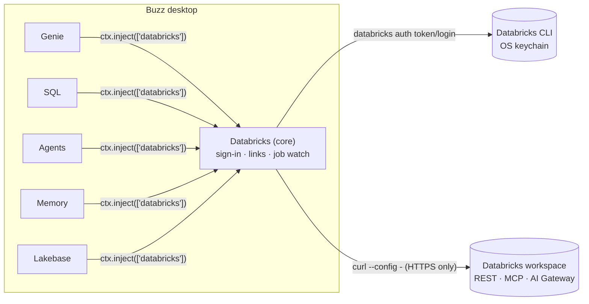

# Design

## Shape of the suite



- **One core plugin owns access.** `bkvarda.databricks` is the only plugin with `host` grants. It provides a versioned `databricks` Cordis service (`packages/core/src/service.ts`). Feature plugins consume it with `ctx.inject`, so their contributions appear and disappear with it. Their pages stay registered and offer to install the core plugin when it is missing.
- **Shared code is bundled, not shared at runtime.** Each `plugin.js` is one self-contained ES module, which is what API v1 requires. Because each plugin carries its own copy of `packages/core`, cross-plugin checks are structural (`error.name`, `service.version`), never `instanceof`.
- **UI follows Buzz, identity follows Databricks.** Surfaces, text, controls and both color modes use Buzz's public CSS roles (`--surface-panel`, `--text-standard`, …). Databricks brand mappings are scoped under `[data-dbx]` as `--dbx-*`, following the pattern GitHub uses with `--github-*`. They cover the mark, brand actions, Databricks object status, SQL keywords and the chart palette, and Lava text is darker on light surfaces and lighter on dark ones. There is no global stylesheet beyond selectors scoped to plugin roots, and no theme provider. The scoped stylesheet's element is keyed by a hash of its content, so a plugin updated while Buzz runs adds its new rules instead of finding the old element and stopping. Controls are styled for WebKit, which Buzz's webview uses: native `<select>` drawing is turned off (`appearance: none`) so selects match the other inputs. Web pages open through `openExternal`, which clicks a hidden `target="_blank"` link: Buzz's desktop opener (tauri-plugin-opener) sends those clicks to the default browser, but `window.open` does nothing there.

## Sign-in and transport

Buzz lets `ctx.host.request` reach only exact origins fixed in the manifest (at most 16, no wildcards), but every Databricks customer has their own workspace URL. Buzz's native OAuth helper binds an ephemeral loopback port, which doesn't match Databricks' fixed-redirect public clients, and Databricks asks third-party tools not to reuse the CLI's OAuth client. So:

- **Auth goes through the official Databricks CLI.** `databricks auth login` handles U2M with PKCE. Without a host it opens `login.databricks.com`, where the person picks a workspace. `databricks auth token` returns a fresh token and refreshes it as needed, with tokens stored in the OS keychain (CLI ≥ 1.0). This is the same `databricks-cli` auth type the Databricks SDKs support. People with an existing profile need no clicks. Tokens are cached in memory until 3 minutes before expiry and fetched single-flight. A 401 forces one refresh and a retry. With `--output json`, CLI 1.x reports failures as JSON on stdout (`{"error_code": "UNAUTHENTICATED", "message": …}`) with an empty stderr, so `cliFailure` reads both; `UNAUTHENTICATED` (or a message about refresh tokens or `auth login`) means "sign in again".
- **HTTP goes through curl.** curl ships with macOS, Linux and Windows 10+, reaches any HTTPS origin, and streams responses, which SSE needs. The URL, method, headers, bearer token and body are written to curl's stdin as a config file (`--config -`), so secrets never appear in `ps`. The manifest pins `--proto =https`. Headers are validated against injection, and bodies use `data-raw`, which never reads `@file`. Tests run the real curl through the same declared process.
- **Install is one click.** If the CLI is missing, a ≤1 KiB declared installer resolves the latest release, verifies its SHA-256 against the published sums, and installs it into `~/.local/bin`, which Buzz searches.

## What each ask maps to

| Ask | Built | Notes |
| --- | --- | --- |
| Databricks Sandboxes as a remote agent | **Databricks** agent type with **Give it a Databricks Sandbox**, plus Genie and MCP servers it can use and its own workspace (see *Agent tools and workspaces*). The model runs on Databricks (AI Gateway). The agent's workspace is its own Sandbox (`/api/2.0/sandboxes`, `sandbox-exec/…/exec-sync`, `sandbox-files`), created on first use and restarted when stopped. Buzz tools run locally through the harness kit. | Execution and state live in Databricks; orchestration runs in Buzz, so the agent works while Buzz is open. A fully hosted variant is designed below. |
| Genie / Genie One | Genie page, composer tool, link panels, an @-mentionable **Genie** agent type, and agent tools for Genie agents (Conversation API) and **Genie One** (`/ai-gateway/mcp-services/system.ai.genie_one_mcp`). Genie One is the first entry on the Genie page (and the default when no Genie agent is shared): a live thinking timeline, then the answer, an auto chart or table, the SQL and a deep link. | Results render natively: tables, auto charts, SQL, follow-ups. See *Genie One rendering* below. |
| Lakebase | Managed memory and sessions are Lakebase-backed. The **Lakebase** plugin gives agents Data API reads. Settings lists the workspace's Lakebase projects and adds a database in one click: the Data API URL is derived from the default branch's read-write endpoint (`https://<host>/api/2.0/workspace/<workspace-id>/rest/<database>`). | The Data API reads as the person, through a Postgres role a project owner creates with `databricks_create_role` and grants to `authenticator`. Roles made in the Lakebase UI or API, and owners themselves, can't be used; Settings shows the exact SQL. |
| Memory | **Databricks Memory**: search/read/write/list/delete tools for every agent, plus a Settings view to browse, search and forget entries. | `actor_id` is the signed-in user, set by the plugin. Pointing at the same store a Databricks-hosted agent uses shares memory with it. |
| Genie agents / custom agents | **Genie** (Genie One by default, or a Genie agent) and **Databricks custom agent** types. Custom agents are Model Serving endpoints (Responses, ChatAgent or chat formats, detected from the endpoint task) or Databricks Apps (Agent Runtime `/api/invocations`, then `/responses`). | One Genie conversation or agent session per Buzz thread. |
| Databricks SQL MCP | SQL tools and the ` ```sql ` Run action call the Statement Execution API directly. The MCP client (`packages/core/src/api/mcp.ts`) speaks Streamable HTTP to Unity Gateway MCP services such as `system.ai.dbsql`, Genie One and the `/api/2.0/mcp/*` servers. | The direct API works without the Unity Gateway beta; MCP is used where it adds capability (Genie One). |
| Other | Live chips and panels for job, run, pipeline, table and dashboard links. A **job-run Attention source** wakes an agent when a run finishes. A read-only `databricks_api_get` escape hatch. A Unity Catalog browser. | |

## Agent tools and workspaces

The plugin registers one agent type, **Databricks**, so Buzz's Harness list has one Databricks entry. Its config has a `kind`, chosen first in the form, which decides the rest:

- **Genie One** (default): only a workspace. Mentions go to Genie One and replies carry its answer, a chart, the SQL and a link; each thread keeps its Genie One conversation.
- **Sandbox agent:** a model, tools, conversation scope and instructions. The model list is AI Gateway's: Unity Catalog model services (`GET /api/2.1/unity-catalog/model-services`, paginated), kept to those supporting `mlflow/v1/chat/completions`, with `capabilities.function_calling` false shown but not selectable. Turns call the gateway (`/ai-gateway/mlflow/v1/chat/completions`) with the service's full name. Some models (GPT-5.6) refuse tools on chat completions unless `reasoning_effort` is `none`; the client retries that way once the gateway says so and remembers it per model. The agent always has its Sandbox, unless the workspace doesn't have the preview on (checked every 10 minutes), in which case it is told it can't run code.
- **Custom agent:** one agent picked from what exists in the workspace: agents on Model Serving (Agent Bricks, `agent/*` tasks or agent tags) and custom chat endpoints, Databricks Apps (`GET /api/2.0/apps`), and Genie agents. Unity Catalog `agent-services` can't be invoked yet (registration only in its beta), so they aren't listed.

Model, tool and agent choices are searchable, grouped, scrolling lists (`SinglePicker`, `MultiPicker` in `plugins/agents/src/ui.tsx`); tools show chips for what's chosen. Watches and timers run only for Sandbox agents.

Every kind chooses, in its settings:

- **Workspace.** "Same as Buzz", another Databricks CLI profile, or a new browser sign-in. The core service's `forProfile(name)` and `addWorkspace({host})` return services backed by their own `Connection` (the same class, CLI broker, token refresh and curl transport as the main sign-in), with in-memory selection storage so the main connection never changes. Only the core plugin touches the host. When a workspace's sign-in has expired, the form offers **Sign in again**: the service's `reauthenticate()` runs `databricks auth login --profile <name> --host <host>` for that same profile, the form waits with a Cancel button as Settings does, and a cancel goes back to the message. Buzz's own connection gets the same buttons in the form (Sign in again, or Sign in with Databricks when signed out).
- **MCP services that need your own login** (GitHub, Slack, Atlassian, Gmail, Google Drive and Calendar, Microsoft 365: connection kind `CONNECTION_HTTP_OAUTH_U2M_MAPPING`). The form checks each with the Beta credential API, `GET /api/2.1/unity-catalog/mcp-services/<name>/user-credentials`: a credential in state `ACTIVE` means logged in, and `NOT_FOUND` means not yet. Not-logged-in servers say so in the list, and a chosen one gets **Log in to GitHub**, which opens Databricks' own login page (`/mcp-service-login?name=<name>`). The form then re-checks every 3 seconds for up to 5 minutes, and again whenever Buzz is focused. When the gateway rejects a turn's `tools/list` with HTTP 401 for such a service, the agent's tools note gives it that link to pass on.
- **Genie** (Sandbox agents). Genie One (on by default) and any of the workspace's Genie agents, in the same tools list as MCP servers, each as a native tool (`genie_one_ask`, `genie_<name>_ask`).
- **MCP servers** (Sandbox agents). Discovered from the agent's workspace: Unity Gateway MCP services (`GET /api/2.1/unity-catalog/mcp-services`, including the Databricks-provided `system.ai` services such as Databricks SQL, web search, GitHub and Slack), Unity Catalog connections marked `is_mcp_connection` (`/api/2.0/mcp/external/<name>`), and Unity Catalog functions in a schema the person names (`/api/2.0/mcp/functions/<catalog>/<schema>`). At the start of a turn the agent lists each chosen server's tools and offers them as `<server>__<tool>`; a server that doesn't answer is reported to the model, not fatal. The picker marks services that need the person's third-party account and that Databricks SQL's MCP server, unlike the suite's SQL tool, isn't read-only.

An agent on another workspace also gets the SQL tools bound to that workspace, and the Buzz workspace's `databricks_*` tools are hidden from it (memory tools stay, because memory follows the person).

## Agent harness

The agent types use `ctx.agents.harness` (block/buzz-app#2364), the same Buzz side of a turn that the bundled harnesses use. `conversation()` admits only the owner's own (or attested) mentions and wakes. `systemPrompt()` and `turnPrompt()` provide Buzz's prompts with an opaque per-thread cursor. `tools()` is an in-process MCP handler for the Buzz tools, *including every plugin tool* such as Genie, SQL and memory. `reply()` posts as the agent.

`plugins/agents/src/loop.ts` runs the tool loop. The model (OpenAI-compatible tool calling via AI Gateway) sees Buzz tools plus local Sandbox tools. A `send` or `reply_in_subthread` call with `final: true` ends the turn. If the model ends without posting, its text is posted as the reply. Turns for the same conversation are queued, Stop and the session controls (compact, new, interrupt) are supported, and sessions are saved in Buzz's agent storage, trimmed at user turns.

When the host lacks the kit (Buzz builds before #2364), no types register and **Settings → Databricks Agents** says to update Buzz.

### Sandbox harnesses: Claude Code, Codex, Pi (hybrid; no longer registered)

The hybrid Sandbox agent (below) ran its turns from the owner's Buzz; it is superseded by the hosted type next. A Sandbox agent's **Harness** is either **Built-in** (the loop above) or a coding agent that runs inside the agent's own Sandbox (`plugins/agents/src/remote.ts`). Every Sandbox image ships `claude`, `codex` and `pi` as launchers that configure themselves through Unity Gateway (`ug`) with the Sandbox's own credential (the owner's), so the plugin never passes a token.

- **A turn.** Buzz's prompts come from `kit.systemPrompt(…, { tools: false })`, meant for a session whose final message the harness posts, and from `kit.turnPrompt` from the conversation's cursor. A new harness session is shown the whole conversation. The plugin writes the prompt, instructions and a run script under `~/.buzz/runs/<run>`, then starts the script detached (`nohup setsid`, holding none of the command's output). That matters because Databricks' command API waits for anything holding its output and stops a command after about five minutes. It then reads the harness's JSON event log every 2 seconds with `tail -n +N` (complete lines only), turning tool events into Buzz's working steps. The final message is posted with `kit.reply`. Stop and the turn timeout kill the run's process group. Measured end to end: 11–17 seconds a turn.
- **Sessions.** There is one harness session per Buzz conversation, kept in `/home/sandbox-agent` so it survives Sandbox restarts:
  - Claude Code: `--session-id <uuid>`, then `--resume <uuid>`.
  - Pi: `--session-id <uuid>`, which creates or continues.
  - Codex: the thread ID from `thread.started`, continued with `exec resume <id>`.

  The ID is saved as soon as the harness reports it, so a failed turn keeps its context. A saved session the harness can't find any more starts over in a new one. Switching harness starts a new session.
- **Instructions.** Claude Code gets them with `--append-system-prompt-file` and Pi with `--append-system-prompt <file>`. Codex has no such flag, so a new Codex thread gets them in its first message.
- **Models.** Each harness speaks one API:
  - Claude Code: `system.ai.claude-*`.
  - Codex (Responses API at `/ai-gateway/codex/v1`): `system.ai.gpt-*`.
  - Pi: `system.ai` Claude, GPT and Gemini models.

  The form filters the model list to match, and a model that doesn't fit falls back to the harness default. Claude Code's preinstalled default (`databricks-claude-opus-4-6`) is retired, and the gateway answers it with a 403 that Claude Code retries for minutes, so the model is always passed explicitly.
- **Permissions.** **Standard** is each harness's guarded mode:
  - Claude Code: auto mode (`--permission-mode auto`), where a safety check approves or blocks each action.
  - Codex: the `workspace-write` sandbox with network access (`-c sandbox_mode=…`, which `exec resume` also accepts).
  - Pi: file tools only (`--tools read,grep,find,ls,edit,write`), since it has no approval step.

  **Full access** is `bypassPermissions`, `--dangerously-bypass-approvals-and-sandbox`, or Pi's default tools.
- **Limits.** These harnesses don't get Buzz's tools; they answer the conversation they're in. The Genie and MCP picks apply to Built-in only, and watches and timers run on Built-in. Prompt input must be closed (`< /dev/null`), or Pi waits on stdin.

### Hosted Databricks agents (the registered type)

The plugin registers one agent type, **Databricks** (`databricks-hosted`). It is a hosted type (`AgentType.remote`), so Buzz lists it as "Databricks (hosted)", and every agent runs fully remote in its own Databricks Sandbox. The agent answers with the owner's laptop off. Hosted-ness is per type, not per agent, so the earlier local types (the Built-in loop, hybrid harnesses, custom agents) are no longer registered. Agents made with them show "Harness unavailable".

- **Kinds.** **Genie** answers with Genie One, or a chosen Genie agent, as charts and tables, keeping one Genie conversation per Buzz conversation. **Sandbox agent** runs Claude Code, Codex or Pi with the same command builder and event parser as the hybrid harnesses (`src/remote.ts`). The harness is spawned directly in the Sandbox and its output read live.
- **Lifecycle** (`src/hosted.tsx`):
  - `provision` creates the Sandbox (`buzz-hosted-<random>`) and turns off its idle auto-stop (`PATCH /api/2.0/lakebox/sandboxes/<id> {"no_autostop": true}`). It then uploads the runner and runs `keygen`, so the agent's key is made in the Sandbox and never leaves it. A retried creation reuses its pending Sandbox, so it never makes two keys.
  - `activate` writes the runner's config with the owner's NIP-OA tag, starts the runner, and creates the keeper job.
  - `profile` republishes the profile, `interrupt` stops a conversation's turn, and `remove` deletes the job and the Sandbox.
  - Buzz refuses settings saves for hosted agents, so the Settings tab saves through the provider: it rewrites the config, restarts the runner and updates the keeper's schedule.
- **The runner** (`runner/`, bundled for Node by `scripts/build.mjs` and embedded in the plugin as `virtual:agent-runner`):
  - **Talking to the relay.** It uses the relay's HTTP API, as Buzz's own agent processes do (`src/buzz-mcp/node.ts`): `POST /events` and `POST /query`, each NIP-98 signed by the agent, with the owner's attestation in `x-auth-tag`. That header is how the relay admits an agent key. WebSocket sign-in with a fresh agent key was refused ("not a relay member").
  - **Mentions.** It polls `/query` for kind 9 and 40002 messages tagging the agent every 3 seconds. It answers only the owner's own messages, or ones the owner attested (`attestedOwner`, BIP-340 over `nostr:agent-auth:<agent>:<conditions>`).
  - **Conversations and context.** It finds the conversation as the kit does: a thread, or the whole channel for Solo chats (kind 39000 with `t=stream` and the `buzz.solo` label), DMs and channel scope. It reads the thread for context the harness session hasn't seen.
  - **Replies.** It replies with kind 9 (`h`, `e root "" reply` except in Solo chats, `ms`, and the auth tag), split under the relay's frame limit.
  - **Order and safety.** Each conversation's turns run one at a time. Harnesses always use **Standard** permissions, because these agents run unattended.
  - **Profile.** The runner publishes the profile itself (kind 0, `bot: true`, attested), retrying until accepted, in case the relay admits the agent only once Buzz writes its listing after activation.
- **Availability.** **Always on**: the runner never stops, and the keeper (every 30 minutes) restarts the Sandbox after its 24-hour limit or a crash. **Sleep when idle**: the runner stops its own Sandbox after 5 minutes without work, never mid-turn. The keeper wakes it every 15 minutes and it catches up on missed mentions. While the owner's Buzz is open, the plugin touches each sleeping agent's heartbeat every 4 minutes, so it stays awake and answers in seconds.
- **The keeper** (`src/keeper.ts`) is a scheduled serverless job running as the owner (`spark_python_task` on `~/.buzz/agent_keeper.py`). It starts the Sandbox if stopped and runs `runner.mjs start`. It was verified that a serverless job can read and exec in its owner's Sandbox.
- **Not yet.** The agent shows no "working" state or Stop button in Buzz: those come from encrypted observer frames (kind 24200), whose format isn't documented. Buzz's own tools (posting elsewhere, reading other channels) aren't available to these agents. One Sandbox per agent; a shared host Sandbox would be cheaper.
- **Tested.** `tests/runner.test.ts` runs the real runner bundle against a local relay (`tests/fake-relay.ts`, HTTP with NIP-98 and `x-auth-tag`) to check sign-in, owner and attested admission, threads, Solo chats, context and profiles. Live against a workspace: Genie One and Claude Code answered through the runner inside a Sandbox, and the provider's provision, activate, status, wake and remove ran against real APIs.

## Genie One rendering

Genie One's MCP server (tools `genie_ask`, `genie_poll_response`, `genie_get_query_result`, `genie_cancel_response`) answers asynchronously: ask, then poll every few seconds. Each poll's `structuredContent` carries `status`, `progress_steps` (one-line "Thinking: …", "Running SQL: …", "Query result: …" summaries), `final_answer` (Markdown), `query_items` (SQL plus an item ID for `genie_get_query_result`, which returns typed columns and rows) and `deep_link`. The plugin turns that into Buzz components: steps become a live timeline that collapses to "Thought for 32s · 3 steps"; the answer is cleaned of the server's HTML comments, `:citation[…]` directives and embed-only links; typed rows (or, when Genie One answers through a Genie agent and returns none, the answer's own Markdown table) become a chart/table toggle; earlier draft queries sit under a disclosure. The same cleanup feeds the agent tool's text.

### Charts in messages

`kit.reply()` posts text only, so agents carry results in the text: a fenced block with the language `databricks-result` whose body is CSV with a header row. The core plugin registers a code block renderer (`conversation.registerCodeBlock`) that draws it as the same chart/table toggle as the Genie page. Buzz keeps its code frame and Copy button (which copies the CSV) and shows the plain block if the renderer fails or the viewer doesn't have these plugins, so the message stays readable either way. The Genie agent turns each Markdown table in Genie One's answer into a block in place, using Genie One's typed rows when they match, and drops Genie One's "I can't draw charts here" sentences when it does. Specific Genie agents' results and the Databricks agent (told about the block in its system prompt) use the same format. Blocks hold at most 200 rows and note any left out.

### MCP Apps

Some Genie One deployments ship an MCP App (`ui://` resources rendered in a sandboxed iframe that talks JSON-RPC over `postMessage`); the deployment tested here exposes none. Buzz's webview CSP is `default-src 'self'; script-src 'self' blob:`. A properly sandboxed iframe (`srcdoc` without `allow-same-origin`) inherits that policy, so an app's inline scripts can't run, and the only workaround, `allow-same-origin`, would expose Buzz's IPC to remote HTML. Rendering MCP Apps needs a host capability, for example an isolated app view with its own CSP and a `postMessage` bridge to the plugin, which belongs upstream in buzz-app. Until then, the native rendering above covers the same content.

## Verification status

- **Locally:** typecheck against generated `@buzz/author` types from block/buzz-app `main`; 56 unit and integration tests (curl config, trailers and streaming through the real curl, SSE, CLI parsing, result typing and chart planning, SQL read-only detection, URL parsing, Genie and Genie One rendering helpers, Markdown, agent reply formats, the agent loop); every `dist/` passes `buzzodz plugin install`; all six plugins render in the playground with Buzz's design tokens in light and dark modes.
- **Live, against a fresh AWS serverless workspace** (`tests/live.test.ts`, run with `DBX_LIVE_PROFILE=<profile>`): sign-in through the CLI profile; SQL on a serverless warehouse; AI Gateway chat with every default model and tool calling; Genie agent conversation with result rows; Genie One end to end (progress, answer, typed rows, deep link); Sandbox create, exec, chunked file write/read and delete; a full agent turn where a Databricks model uses its Sandbox and posts through Buzz's `send`; managed memory store, write, update, prefix list, semantic search and delete; Lakebase project discovery and Data API URL derivation. In the playground: Genie and Genie One pages with live charts, and one-click Lakebase setup.
- **Not yet verified:** Lakebase Data API row reads (the test workspace's project is owned by automation, so no eligible role exists; the plugin explains the fix), the in-app Buzz run, and the Databricks agent types inside Buzz (they need a Buzz build with block/buzz-app#2364).

### Findings from live testing

- The Sandbox API answers "requested API is not available" until a workspace admin turns on the **Databricks Sandbox** preview, and for a few minutes after, while it rolls out. `ensureRunning` retries those, and reports the preview requirement in plain language.
- The public Sandbox API has no file endpoints, so files move through `exec-sync`: base64 in environment variables (never in arguments), 96 KiB chunks. `directory-entries` answers in camelCase and is used when present, with a `find` fallback.
- `exec-sync` responses end with an HTTP trailer (`grpc-status: 0`), which `curl --include` prints after the body. The transport asks curl for `%{size_download}` after a per-request marker and cuts the body at that byte count.
- A CLI profile can keep the workspace ID of a deleted workspace at the same URL. The client uses the ID the server reports (`x-databricks-org-id`) for routing headers.
- Managed memory lists under `managed_memory_entries`, filters with `path` (exact) or `path_prefix`, and returns search hits as `results[].managed_memory_entry` with a score.
