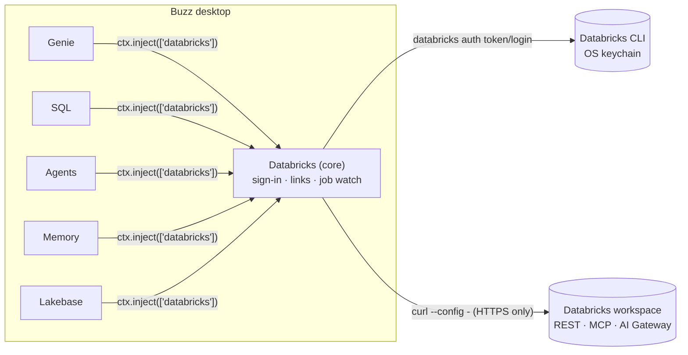

# Design

## Shape of the suite



- **One core plugin owns access.** `bkvarda.databricks` is the only plugin with `host` grants. It provides a versioned `databricks` Cordis service (`packages/core/src/service.ts`). Feature plugins consume it with `ctx.inject`, so their contributions appear and disappear with it. Their pages stay registered and offer to install the core plugin when it is missing.
- **Shared code is bundled, not shared at runtime.** Each `plugin.js` is one self-contained ES module, which is what API v1 requires. Because each plugin carries its own copy of `packages/core`, cross-plugin checks are structural (`error.name`, `service.version`), never `instanceof`.
- **UI follows Buzz, identity follows Databricks.** Surfaces, text, controls and both color modes use Buzz's public CSS roles (`--surface-panel`, `--text-standard`, …). Databricks brand mappings are scoped under `[data-dbx]` as `--dbx-*`, following the pattern GitHub uses with `--github-*`. They cover the mark, brand actions, Databricks object status, SQL keywords and the chart palette, and Lava text is darker on light surfaces and lighter on dark ones. There is no global stylesheet beyond selectors scoped to plugin roots, and no theme provider.

## Sign-in and transport

Buzz lets `ctx.host.request` reach only exact origins fixed in the manifest (at most 16, no wildcards), but every Databricks customer has their own workspace URL. Buzz's native OAuth helper binds an ephemeral loopback port, which doesn't match Databricks' fixed-redirect public clients, and Databricks asks third-party tools not to reuse the CLI's OAuth client. So:

- **Auth goes through the official Databricks CLI.** `databricks auth login` handles U2M with PKCE. Without a host it opens `login.databricks.com`, where the person picks a workspace. `databricks auth token` returns a fresh token and refreshes it as needed, with tokens stored in the OS keychain (CLI ≥ 1.0). This is the same `databricks-cli` auth type the Databricks SDKs support. People with an existing profile need no clicks. Tokens are cached in memory until 3 minutes before expiry and fetched single-flight. A 401 forces one refresh and a retry.
- **HTTP goes through curl.** curl ships with macOS, Linux and Windows 10+, reaches any HTTPS origin, and streams responses, which SSE needs. The URL, method, headers, bearer token and body are written to curl's stdin as a config file (`--config -`), so secrets never appear in `ps`. The manifest pins `--proto =https`. Headers are validated against injection, and bodies use `data-raw`, which never reads `@file`. Tests run the real curl through the same declared process.
- **Install is one click.** If the CLI is missing, a ≤1 KiB declared installer resolves the latest release, verifies its SHA-256 against the published sums, and installs it into `~/.local/bin`, which Buzz searches.

## What each ask maps to

| Ask | Built | Notes |
| --- | --- | --- |
| Databricks Sandboxes as a remote agent | **Databricks** agent type with **Give it a Databricks Sandbox**. The model runs on Databricks (AI Gateway). The agent's workspace is its own Sandbox (`/api/2.0/sandboxes`, `sandbox-exec/…/exec-sync`, `sandbox-files`), created on first use and restarted when stopped. Buzz tools run locally through the harness kit. | Execution and state live in Databricks; orchestration runs in Buzz, so the agent works while Buzz is open. A fully hosted variant is designed below. |
| Genie / Genie One | Genie page, composer tool, link panels, an @-mentionable **Genie** agent type, and agent tools for Genie agents (Conversation API) and **Genie One** (`/ai-gateway/mcp-services/system.ai.genie_one_mcp`). | Results render natively: tables, auto charts, SQL, follow-ups. See *MCP Apps* below. |
| Lakebase | Managed memory and sessions are Lakebase-backed. The **Lakebase** plugin gives agents Data API reads, plus project discovery. | Data API access is governed by each person's Postgres role and grants. |
| Memory | **Databricks Memory**: search/read/write/list/delete tools for every agent, plus a Settings view to browse, search and forget entries. | `actor_id` is the signed-in user, set by the plugin. Pointing at the same store a Databricks-hosted agent uses shares memory with it. |
| Genie agents / custom agents | **Genie** and **Databricks custom agent** types. Custom agents are Model Serving endpoints (Responses, ChatAgent or chat formats, detected from the endpoint task) or Databricks Apps (Agent Runtime `/api/invocations`, then `/responses`). | One Genie conversation or agent session per Buzz thread. |
| Databricks SQL MCP | SQL tools and the ` ```sql ` Run action call the Statement Execution API directly. The MCP client (`packages/core/src/api/mcp.ts`) speaks Streamable HTTP to Unity Gateway MCP services such as `system.ai.dbsql`, Genie One and the `/api/2.0/mcp/*` servers. | The direct API works without the Unity Gateway beta; MCP is used where it adds capability (Genie One). |
| Other | Live chips and panels for job, run, pipeline, table and dashboard links. A **job-run Attention source** wakes an agent when a run finishes. A read-only `databricks_api_get` escape hatch. A Unity Catalog browser. | |

## Agent harness

The agent types use `ctx.agents.harness` (block/buzz-app#2364), the same Buzz side of a turn that the bundled harnesses use. `conversation()` admits only the owner's own (or attested) mentions and wakes. `systemPrompt()` and `turnPrompt()` provide Buzz's prompts with an opaque per-thread cursor. `tools()` is an in-process MCP handler for the Buzz tools, *including every plugin tool* such as Genie, SQL and memory. `reply()` posts as the agent.

`plugins/agents/src/loop.ts` runs the tool loop. The model (OpenAI-compatible tool calling via AI Gateway) sees Buzz tools plus local Sandbox tools. A `send` or `reply_in_subthread` call with `final: true` ends the turn. If the model ends without posting, its text is posted as the reply. Turns for the same conversation are queued, Stop and the session controls (compact, new, interrupt) are supported, and sessions are saved in Buzz's agent storage, trimmed at user turns.

When the host lacks the kit (Buzz builds before #2364), no types register and **Settings → Databricks Agents** says to update Buzz.

### Hosted Sandbox agents (next step)

Buzz also supports hosted agent types (`AgentType.remote`), where a provider holds the agent's key and runs it while Buzz is closed. The plan for a hosted Sandbox agent is: `provision` creates the Sandbox and generates the agent's Nostr key inside it, so the key never leaves Databricks; `activate` hands over the owner's NIP-OA attestation (`host.prepareRemoteAgentAuthorization`) and starts a small runner under `nohup` that subscribes to the community relay and runs the same loop with Buzz's standalone MCP tools; and `remove` deletes the Sandbox. This needs relay reachability from Databricks serverless egress, a restart policy for the Sandbox's 24-hour run limit, and a decision on where the Buzz tool server runs.

## MCP Apps

Genie One ships an MCP App (`view_ask`, with `ui://` resources rendered in a sandboxed iframe that talks JSON-RPC over `postMessage`). Buzz's webview CSP is `default-src 'self'; script-src 'self' blob:`. A properly sandboxed iframe (`srcdoc` without `allow-same-origin`) inherits that policy, so the app's inline scripts can't run. The only workaround, `allow-same-origin`, would expose Buzz's IPC to remote HTML. So these plugins render Genie One's tool results natively. Rendering MCP Apps needs a host capability, for example an isolated app view with its own CSP and a `postMessage` bridge to the plugin, which belongs upstream in buzz-app.

## Verification status

- Verified locally: typecheck against generated `@buzz/author` types from block/buzz-app `main`. Unit tests cover curl config quoting and header parsing, SSE, CLI parsing, result typing and chart planning, SQL read-only detection, URL parsing, Genie summaries, agent reply formats, Markdown, and the agent loop with fake model and tools. Integration tests run real curl (GET, POST escaping, streaming, failure) and the real CLI (version, profiles). Every `dist/` passes `buzzodz plugin install` validation. All six built plugins activate in the playground with Buzz's design tokens in light and dark modes.
- Pending a live workspace: end-to-end calls for Genie, Genie One MCP argument schemas, Sandbox exec, managed memory and sessions, Lakebase Data API, AI Gateway tool calling, and the in-app Buzz run. Endpoint shapes come from Databricks docs and `databricks-sdk` 0.161.
