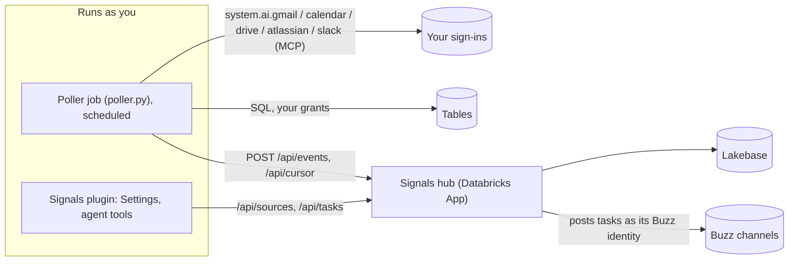

# Signals

Turn events from your own sources into tasks in your team's Buzz channels.

- **Sources** are read **as you**, with your own sign-ins: Gmail, Google Calendar, Google Drive, Jira (Atlassian), and Slack, through the Unity Catalog MCP services in `system.ai`, plus any Databricks table you can read.
- **Every source is off** until you turn it on in **Settings → Signals**. You can turn one off at any time, or use **Forget** to also delete what the hub keeps from it.
- **The hub** is a Databricks App with a Lakebase database. It keeps one record per thing (a mail, a meeting, a ticket, a table row) and notices when one changes. The team's **rules** then decide whether a change opens a task, updates a task, or is only recorded. New tasks are posted in their account's channel, and later events go in the task's thread.
- **Agents** get `signals_tasks`, `signals_task`, `signals_task_update` (status, notes, artifacts) and `signals_event`.

## How it fits together



**Why a job and not the app?** An app's on-behalf-of token lasts about six minutes, comes without a refresh token, and only arrives with a request. That makes it fine for the Settings card, but the app can't use it to read your mail at 3am, and its service principal can't use your sign-ins. A scheduled job owned by you runs as you and can.

## Deploy

1. **Build:** `npm run build` writes `plugins/signals/hub/`, which holds `app.mjs` (the hub plus its Postgres driver), `app.yaml`, `signals.config.json` (example rules), `poller.py` and `sources.example.json`.
2. **Hub:**
   1. Create a Databricks App whose description starts with **`Signals hub`**; that's how the plugin finds it.
   2. Give it a Lakebase database resource named `postgres` with *Can connect and create*.
   3. Upload `hub/` and deploy it.
   4. Give the people who'll use it **Can Use** on the app.
   5. To post tasks to Buzz, give it a Buzz identity: in Buzz, go to **Agents → New agent → Databricks App → Connect an app you have** and set `BUZZ_IDENTITY_SECRET` in `app.yaml`.
3. **Rules:** edit `signals.config.json` before deploying. Admins (set with `SIGNALS_ADMINS`) can also `POST /api/config`.
4. **Each person:**
   1. Turn sources on in **Settings → Signals**.
   2. Create a scheduled job (serverless, every 15 minutes, say) **owned by them** that runs `poller.py --config sources.json --hub <app url> [--warehouse <id>]`.
   3. Try it first with `--dry-run`, which reads every source and prints the events without the hub.

## Rules

```json
{
  "version": 1,
  "first_run_seen": true,
  "accounts": [{ "name": "Example Co", "channel": "<buzz channel id>", "aliases": ["Example"], "when": { "actor": "@example\\.com" } }],
  "rules": [
    { "id": "no-automated-mail", "sources": ["gmail"], "when": { "actor": "noreply" }, "action": "ignore" },
    { "id": "customer-mail", "sources": ["gmail"], "when": { "actor": "@example\\.com" }, "action": "task", "title": "Reply: {title}", "group_by": "group_key" },
    { "id": "cases", "sources": ["table.*"], "when": { "payload.status": ["Awaiting Confirmation"] }, "action": "task", "group_by": "external_id", "stale_after_hours": 72, "nudge": "{external_id} has waited {hours}h" },
    { "id": "auto-increases", "sources": ["table.quota"], "when": { "payload.kind": "auto" }, "action": "update", "group": "quota", "group_by": "payload.workspace" },
    { "id": "quota-requests", "sources": ["table.quota"], "action": "task", "group": "quota", "group_by": "payload.workspace" }
  ]
}
```

- Rules are checked **in order**, and the first match wins.
  - In `when` and `unless`, a string is a case-insensitive regular expression and a list is a set of exact values.
  - Fields are the event's own (`title`, `actor`, `account`, `url`, `group_key`, `external_id`) or `payload.<name>`.
  - All `when` conditions must hold. Any one `unless` condition excludes the event.
- There are three actions:
  - `task` opens or updates the task for the event's group.
  - `update` only adds the event to a task that already exists for its group.
  - `ignore` records the event and does nothing else.
- **Groups:** events with the same `group_by` value share one task, across everyone. Rules with the same `group` (default: the rule's id) share tasks, so an `update` rule names the group of the rule that opens them. When two people get the same thread, it becomes one task.
- **First run:** with `first_run_seen` on, a source's first post for a person only records what's already there, so turning a source on doesn't flood the channel.
- **Nudges:** with `stale_after_hours`, an open task whose latest event still matches the rule after that many hours gets a nudge in its thread, at most once per period.
- **Accounts:** the account comes from the rule's `account`, then the event's own `account` (matched by name or alias), then the first account whose `when` holds. The account's `channel` is where its tasks are posted; tasks without one go to `default_channel`.

## Sources (`sources.json`)

- **`mcp` sources** call a tool of a `system.ai` service.
  - `args` and `map` are templates: `{since}` (the source's cursor, or `lookback_hours` back), `{now}`, `{now+7d}`, `{since_epoch}`, `{since_date}`, and `{field.path}` for a field of the item.
  - `items` is where the list sits in the tool's JSON.
  - When you aren't signed in, the source is reported as unavailable, with the sign-in link.
- **`table` sources** run a query with a `:since` parameter.
  - `table` is checked first. A table that's missing, or one you can't read, makes the source unavailable instead of failing.
  - The cursor is the largest `watermark` value seen.
- **`map`** turns an item into an event:
  - `external_id` (required)
  - `title`, `url`, `actor`, `account`, `group_key`, `occurred_at`
  - `payload`: a list of fields, `"*"` for the whole item, or an object of templates

The hub keeps each source's cursor. The cursor only moves once the hub has the events.

## Privacy

- The hub only takes events for sources the person turned on. Who sent an event comes from Databricks Apps (`X-Forwarded-Email`), never from the request body.
- Posts to Buzz contain only a task's title, account and links, never a mail's body.
