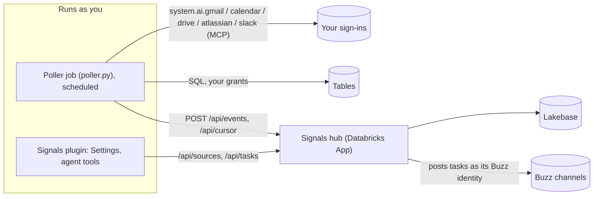

# Signals

Turn events from your own sources into tasks in your team's Buzz channels.

- **Sources** are read **as you**, with your own sign-ins: Gmail, Google Calendar, Google Drive, Jira (Atlassian), and Slack, through the Unity Catalog MCP services in `system.ai`, plus any Databricks table you can read.
- **Every source is off** until you turn it on in **Settings → Signals**. You can turn one off at any time, or use **Forget** to also delete what the hub keeps from it.
- **The hub** is a Databricks App with a Lakebase database. It keeps one record per thing (a mail, a meeting, a ticket, a table row) and notices when one changes. The team's **rules** then decide whether a change opens a task, updates a task, or is only recorded. New tasks are posted in their account's channel, and later events go in the task's thread.
- **Agents** get `signals_tasks`, `signals_task`, `signals_task_update` (status, notes, artifacts) and `signals_event`.

## How it fits together



**Why a job and not the app?** An app's on-behalf-of token lasts about six minutes, comes without a refresh token, and only arrives with a request. That makes it fine for the Settings card, but the app can't use it to read your mail at 3am, and its service principal can't use your sign-ins. A scheduled job owned by you runs as you and can.

## Deploy

1. **Build:** `npm run build` writes `plugins/signals/hub/`, which holds `app.mjs` (the hub plus its Postgres driver), `app.yaml`, `signals.config.json` (example rules), `poller.py` and `sources.example.json`.
2. **Hub:**
   1. Create a Databricks App whose description starts with **`Signals hub`**; that's how the plugin finds it.
   2. Give it a Lakebase database resource named `postgres` with *Can connect and create*.
   3. Upload `hub/` and deploy it.
   4. Give the people who'll use it **Can Use** on the app.
   5. To post tasks to Buzz, give it a Buzz identity: in Buzz, go to **Agents → New agent → Databricks App → Connect an app you have** and set `BUZZ_IDENTITY_SECRET` in `app.yaml`.
3. **Rules:** the example `signals.config.json` works for any account a team sets up (see [Rules for every account](#rules-for-every-account)), so a new account needs no rule changes. Edit it before deploying for your own kinds of work. Admins (set with `SIGNALS_ADMINS`) can also `POST /api/config`.
4. **Each person:**
   1. Turn sources on in **Settings → Signals**. If the hub runs in another workspace than Buzz's, pick it under **Workspace** there first; the agent tools follow that choice too.
   2. Create a scheduled job (serverless, every 15 minutes, say) **owned by them** that runs `/Workspace/Users/<email>/signals-poller/poller.py --config /Workspace/Users/<email>/signals-poller/sources.json --lakebase [--warehouse <id>]` (a full path: the job's working directory isn't that folder), with `psycopg[binary]` as a dependency. Give them a Postgres role in the hub's database (Lakebase → Roles → add their Databricks identity). `POST /api/onboard`, as them, creates that role when the hub can (it needs the `databricks_auth` extension in the database and `CREATEROLE` on the app's role). Otherwise it says why and gives the `databricks postgres create-role` command for someone with Can Manage on the project. `GET /api/onboard` only looks. **Settings → Signals → Your poller** does all of this as them: **Create my role**, then **Create my job**, which writes `poller.py` and a `sources.json` (the example's personal `mcp` sources, Slack only if they give their Slack user id, and the hub's `lakebase`) to `/Workspace/Users/<email>/signals-poller`, creates the job "Signals poller (<email>)" (serverless, every 15 minutes, `databricks-sdk` and `psycopg[binary]`) and starts a first run. Running it again (or with a job they made by hand that runs `poller.py` from that folder) updates that job's poller task and `poller.py` but keeps an existing `sources.json`. Shared table sources aren't in it; one job reads those for everyone. Both give the `lakebase` settings for their `sources.json` and the job's arguments.
   3. From a laptop signed in with `databricks auth login`, `--hub <app url>` works too, and replies with what each post did.
   4. Try it first with `--dry-run`, which reads every source and prints the events without the hub.

### How a job reaches the hub

Databricks Apps only take OAuth tokens, and a job's token isn't one, so a job can't call the hub's API. It can log in to Lakebase as its owner, though, so `--lakebase` writes to the hub's **inbox** table instead:

- Each person can insert only `kind` and `body`. The row's `owner` is always their own Postgres role (`current_user`), so a post can't claim to be from someone else.
- Row-level security shows each person only their own inbox rows and only their own `sources` rows (source, enabled, cursor, last post, last error). They can't change either table.
- The hub drains the inbox every 30 seconds, through the same path as `POST /api/events` and `POST /api/cursor`, and deletes handled rows after a week.
- Add to `sources.json`: `"lakebase": {"endpoint": "projects/<p>/branches/<b>/endpoints/<e>", "host": "<endpoint host>", "database": "databricks_postgres", "schema": "signals_<app name>"}`. The schema is on the hub's status page.
- Roles with `BYPASSRLS` (Lakebase project owners) aren't limited by these policies. They can read the database anyway.

### Sources in another workspace

Some tables live only in another workspace than the hub's. Run the poller for those sources from a laptop, as yourself, with two profiles: the default one for the workspace with the tables (SQL and MCP calls), and `hub_auth` for the hub's workspace (every hub call: `/api/sources`, `/api/events`, `/api/cursor`, `/api/ids`).

1. Sign in to both: `databricks auth login --profile <tables profile>` and `databricks auth login --profile <hub profile>`.
2. Give that run its own `sources.json` with only those sources, `"hub": "<app url>"` and `"hub_auth": {"profile": "<hub profile>"}`.
3. Run it, every 15 minutes say (cron or launchd): `DATABRICKS_CONFIG_PROFILE=<tables profile> python poller.py --config sources.json --hub <app url> --warehouse <id in the tables workspace>`.

- Its events are yours, like the ones your job posts: the same sources turned on in **Settings → Signals**, cursors and accounts. A source you post from both places shares one cursor, so give each source to only one of them.
- While the laptop is asleep or offline, those sources pause; the next run picks up from their cursors.
- `hub_auth` works only with `--hub`. With `--lakebase` the poller stops and says so.
- A job can't do this as a service principal. Databricks Apps doesn't send the hub an email for a service principal, so the hub turns its calls away (HTTP 401), and the hub keeps sources per person anyway.

## Rules for every account

The example rules don't name an account. They say "from the customer", and the accounts teams set up in their channels say who the customer is:

- `customer_actor: true`: the event's `actor` is at one of an account's email domains (mail from the customer, a Slack message from a customer address).
- `customer_attendees: true`: the meeting has a real customer among its attendees, at one of an account's domains. A colleague's address at the customer's domain doesn't count (see below).
- `account_named_in: "<field>"`: the field names an account, by its name or one of its other names, as whole words. `payload.channel` finds `ext-globex-team` for Globex, which helps in shared Slack channels where the customer's people show no email; `title` finds a meeting's notes, `Globex sync - Notes by Gemini`.
- `skip_own: true`: skip events whose `actor` is the person whose source sent them, like your own Slack messages.
- `known_account: true`: only events about an account the hub knows, one set up in a channel or a config account, found by its name, other names, ids or domains. An event that names some other company opens nothing, rather than a task in `default_channel`. This suits ticket sources that match loosely, where `Customer ~ "Acme"` can also return "Acme Party Inc".

A rule with one or more of the first three applies when any of them holds. The task then goes to that account, and to its channel. With `true`, these rules apply to every account set up in the panel, and to config accounts with `domains`. They can still be patterns instead (`"customer_attendees": "@example\\.com$"`), which apply only to addresses that match. A rule's `account` still overrides the account it finds.

**Sources that know the account.** A table or ticket source that's about one account should say which in the event's `account` (its `map` has `"account": "account_name"`, say). The account's name or other names (an id from another system works as an other name) then match it, with no rule naming the account. A source's query can cover all your accounts instead of one: select the account column, map it to `account`, and give each account that value as one of its other names. A query that only fits one account (`WHERE account_id = '...'`) means every person edits it for each new account.

**Account ids in queries.** A table or ticket source that reads only your accounts' rows needs their ids, and those differ per account. Give each account its ids in the panel's **Ids in other systems**, a line per kind (`crm: 0016100000AbCdE`, `jira_customer: Example, Example Co`), or as `ids` on a config account (`"ids": {"crm": ["0016100000AbCdE"]}`). A kind is a lowercase name of your choosing. The source then names the kinds it uses, `"ids": ["crm"]`, and the poller fills in every account's ids of each kind, read from the hub (`GET /api/ids`, or the `account_ids` table for jobs that reach it through Lakebase):

- **SQL:** `:crm` in a table source's query becomes one bound parameter per id, so `WHERE account_id IN (:crm)` runs as `IN (:crm_0, :crm_1)`. The ids are never pasted into the statement.
- **Tool args (JQL, say):** `{crm: <clause>}` becomes the clause once per id, joined by `OR`, with `{}` as the id. Backslashes and double quotes in the id are escaped, for use inside a quoted string: `({jira_customer: "Customer" ~ "{}"})` becomes `("Customer" ~ "Example" OR "Customer" ~ "Example Co")`.
- **No ids yet:** when no account has ids of a kind a source uses, the poller skips the source and reports it as unavailable, saying which kind is missing.

Map the source's account column to `account`. An account's ids count as its names, so the event then finds the account by an id, as well as by its name or other names. The example `table.usage` and `jira_customers` sources in `sources.example.json` work this way. With ids, a new account needs only the panel, and no one edits the sources.

**Slack.** The example `slack` source fetches only the messages that mention whoever runs it, so its rule needn't name anyone. Don't put a person's Slack id in a shared rule: it would only match that person's mentions.

## Rules

```json
{
  "version": 1,
  "first_run_seen": true,
  "accounts": [{ "name": "Example Co", "channel": "<buzz channel id>", "aliases": ["Example", "EX-1001"], "domains": ["example.com"] }],
  "rules": [
    { "id": "no-automated-mail", "sources": ["gmail"], "when": { "actor": "noreply" }, "action": "ignore" },
    { "id": "customer-mail", "sources": ["gmail"], "customer_actor": true, "action": "task", "title": "Reply: {title}", "group_by": "group_key" },
    { "id": "cases", "sources": ["table.*"], "when": { "payload.status": ["Awaiting Confirmation"] }, "action": "task", "group_by": "external_id", "stale_after_hours": 72, "nudge": "{external_id} has waited {hours}h" },
    { "id": "auto-increases", "sources": ["table.quota"], "when": { "payload.kind": "auto" }, "action": "update", "group": "quota", "group_by": "payload.workspace" },
    { "id": "quota-requests", "sources": ["table.quota"], "action": "task", "group": "quota", "group_by": "payload.workspace" }
  ]
}
```

- Rules are checked **in order**, and the first match wins.
  - In `when` and `unless`, a string is a case-insensitive regular expression and a list is a set of exact values.
  - Fields are the event's own (`title`, `actor`, `account`, `url`, `group_key`, `external_id`) or `payload.<name>`.
  - All `when` conditions must hold. Any one `unless` condition excludes the event.
- There are three actions:
  - `task` opens or updates the task for the event's group.
  - `update` only adds the event to a task that already exists for its group.
  - `ignore` records the event and does nothing else.
- **Groups:** events with the same `group_by` value share one task, across everyone. `group_by` is a field (`payload.workspace`) or a template (`{payload.workspace}/{payload.region}`; values are trimmed and lowercased, and an event whose fields are all empty is its own group). Rules with the same `group` (default: the rule's id) share tasks, so an `update` rule names the group of the rule that opens them. When two people get the same thread, it becomes one task.
- **First run:** with `first_run_seen` on, a source's first post for a person only records what's already there, so turning a source on doesn't flood the channel.
- **Recurring series:** with `series`, a field or a template naming what makes events one series (a meeting's `payload.recurringEventId`), the team decides once per series and account. The first time a series shows up, its task opens in `ask` mode, so no agent starts, and waits with the question **Always / Just this one / Never**. The series' other events are held until someone answers. **Always** opens the series' tasks from now on, in the team's mode, and asks the account's agents to start on this one. **Just this one** goes ahead with this task only, and the series' next event asks again. **Never** dismisses the task, and the series opens no more tasks. The held events then go through the rules again under the answer. Once answered, the task's first message is edited to show its new mode (or that it was dismissed) without the question; the answer and the agents' request are replies in its thread. An answer that isn't one of the three goes to the agents as input, and the series asks again next time. Events without the field open tasks as usual. The example `customer-meetings` rule uses `"series": "payload.recurringEventId"`, and the calendar source puts `recurringEventId` in the payload.
- **Done by itself:** with `done_when`, the hub marks a rule's open tasks done and says why in the thread. Any one of these finishes a task:
  - `when`: the task's latest event matches these conditions, like a ticket whose `payload.status_category` is `["Done"]`. It's checked as each event comes in, even an event the rule itself skips (a rule with `unless` for resolved tickets still hears that its ticket was resolved). A task whose first event is already finished isn't posted.
  - `after`: an event field holding a time, like a meeting's `payload.end` (ISO 8601, Unix seconds, or a calendar `{dateTime}` or `{date}`). The task is done once that time is `grace_hours` past (default 0).
  - `idle_days`: nothing new on the task (no event, no activity) for that many days. The config's `done_idle_days` does this for every rule's tasks, so nothing stays open forever.
  - `by_owner: true`: someone on the team did the work themselves. An event of the task's group whose `actor` is the person whose source sent it (your reply in the customer's Slack thread, mail you sent in the thread) finishes the task as it comes in, even when the rule skips your own messages. The hub records what you did, with its link, makes you the owner if no one was chosen, takes the agents on it off it, and tells them in the thread to stop. A new message from the customer opens it again, still yours. It's decided by time: a reply closes the task only when it's no older than the customer's latest message on it, and a reply that comes in before the customer's message (sources run in any order) closes the task when it opens, without posting it. Your own messages only reach the hub if a source sends them, and each is its own source to turn on in Settings: `gmail.sent` (mail you sent, `in:sent`; the `gmail` source still reads only your inbox) and `slack.sent` (your Slack messages, `from:<@YOUR_SLACK_USER_ID>`). The example `customer-mail` and `customer-slack` rules use it. The example Slack sources key a thread by its channel and its root message's full `thread_ts` (`C123:1795000000.123456`), from the permalink. A Slack task opened under the earlier key (a second: the root's, or the reply's own when a reply opened it) keeps its thread: a message under the new key joins it when it's the only old task holding a message whose stored permalink names that thread, and every Slack message on it names that same thread. It's left alone otherwise (two threads in one second can't be told apart). A team reply and a customer message are ordered by the full time an event gives (Slack's ts to the microsecond), so a reply sent earlier in the same second doesn't close the task. An event saved before that time was kept uses its own Slack permalink's ts (not `thread_ts`, the root's). A customer message older than any team reply already decided on the task doesn't reopen it. Forgetting a source deletes its stored replies too, and a reply being saved or decided while it's forgotten is dropped and closes nothing. A customer message and a team reply decided at the same time take turns on the task row, so the newer of the two wins (an older reply never closes a task over a newer customer message). Forget also takes back what its messages said about a task's times, so a forgotten reply no longer keeps a task closed and a forgotten customer message no longer keeps a reply from closing one. When one post holds both a reply and a newer customer message, the thread gets one message saying the task is open again, with who has it, and no "Done". Two decisions of the same reply at once take turns (one closes the task, the other finds it done). `tests/signals-postgres.test.ts` checks these overlaps on a real PostgreSQL when `SIGNALS_TEST_PG` names one.

  `note` says what the thread is told (`{field}` takes an event field). The sweep checks `after` and `idle_days` every few minutes. Tasks still waiting on a question are left open, and a new event reopens a done task as usual, unless that event is itself past done (notes for a meeting that's over). For example, `"done_when": { "after": "payload.end", "note": "the meeting has ended" }` for meeting prep, and `"done_when": { "when": { "payload.status_category": ["Done"] }, "note": "{external_id} is {payload.status}" }` for Jira (map `status_category` from `fields.status.statusCategory.name`, as `sources.example.json` does).
- **Same thing, several people:** tasks are shared, so two people's events with the same group key land on one task. Some sources give each person their own ids for the same thing: each mailbox has its own Gmail thread id for the same mail. `same_as` is a `{field}` template whose value is the same in every copy, like the example `customer-mail` rule's `{actor}|{title}|{occurred_at}` (the sender, the subject and the mail's Date header). When a new group's event matches a task's, that group joins the task, so each person's later replies in their own thread go there too. Every field it names must be there; an event missing one opens its own task.
- **Classify:** with `classify`, a rule that would open a new task first asks a small model whether the event really needs the team. This keeps receipts, schedule changes and FYI mail from becoming tasks. Give a yes/no `question`, and optionally `true` and `false`, saying what each answer means. The model sees only the event's source, subject (`title`), sender (`actor`), and `payload.to`, `snippet`, `description`, `text` and `status`; the Gmail source puts the mail's `snippet` in the payload. An event the model scores below `min` (default 0.7, the probability of yes) is recorded as filtered with its score and opens nothing. `GET /api/filtered` lists the last 14 days of these (`?days=`, `?source=`, `?rule=`, `?limit=`), so you can check what it held back. The tasks board's **Filtered** view shows them for its channel (`?channel=`, the channel the task would have gone to), each with its rule, its score against `min`, and the question. Only new tasks are asked about: a later event in a thread that already has a task updates it unasked. When the model can't answer, the task opens anyway. The hub asks the serving endpoint `databricks-openjev-qwen35-4b` as its service principal, which needs **Can query** on it. `SIGNALS_CLASSIFIER` in `app.yaml` names another endpoint, or `off`. The example `customer-mail` rule asks "Is the sender asking a question, asking for help, or reporting a problem?"
- **Categories:** `categories` splits a rule's work into finer kinds, each its own workstream, with its own playbook, agents and the team's mode for it (`capacity request: auto`). Each category is `{workstream, when?, about?}`. A new task opens under the first category whose `when` matches the event (the same conditions as a rule's `when`), like `{"workstream": "capacity request", "when": {"title": "increase (RPM|TPM|rate limit)"}}`. When none matches and some categories have an `about` (what that kind of work is, in a sentence), the hub asks the classifier endpoint (above) which of those it is, or none of them. When none fits, or the model can't answer, the task opens under the rule's `workstream`. If the team turned the chosen category's work `off`, no task opens. A category's own mode applies even when the rule's workstream is `off` (`escalation tracking: off` with `capacity request: draft` still opens capacity requests); only a task that falls back to the rule's workstream is turned off with it. The category is decided once, when the task opens, from the event's latest version; later events don't move it, and a closed task opens again only while the team's mode for its own category isn't `off`. A task that moves to another rule keeps its category if that rule has the same one; otherwise it takes that rule's workstream (none, if it names none). Either way it takes the team's mode for its category under that rule (so a rule turned `off` stays off). A task someone filed under a workstream by hand keeps it, even when an event moves it to another rule while the filing is being saved: if that rule has the same category, the task takes the team's mode for it there; otherwise it keeps its mode. (If filings keep landing while the move is written, the hub asks for the post again, and the event is placed when it's posted again.) A team's line for the rule's id still sets the mode for all of its tasks. Up to 20 categories per rule; `fan_out` and `meeting_task` rules take none. A category can have its own `title` template, like `"Capacity request: {payload.model} in workspace {payload.workspace}"`, used instead of the rule's. Each task records how it was filed as `filed_by`: `rule`, `match` (a category's `when`) or `classifier` (with the model's confidence as `filed_score`); tasks opened before this have none.
- **Short titles:** `"summarize_title": true` asks a fast chat model on Model Serving (`SIGNALS_TITLER`, default `databricks-claude-haiku-5-5`; `off` turns it off) to shorten the event's title once, when its task opens: at most 60 characters of plain text, with no @mentions, Markdown, emoji or source word like `Slack:`. The rule's `title` template is then filled with the short title, so `Prep: {title}` keeps its prefix; a category with its own `title` doesn't ask. When the model fails or its title fails those checks, the task keeps its normal title. Whenever the task's title doesn't show the source's own, the task keeps it as `source_title`, and the task's post shows it on a `Title:` line under **Source**. How a task was filed and titled goes in its activity, not its thread. The task also keeps the event it opened with (`title_event`): the tasks board gives it as the task's `origin` (its source, id, title and link), which a later event on the task doesn't change, nor an edit of that same event (the title is the one it opened with). Its `filed_by` and `filed_score` say how its workstream was chosen (`match`: a category's `when` held; `classifier`, with its confidence; `rule`), and are cleared when the task moves to another workstream. Tasks opened before this have no origin.
- **Watched fields:** with `watch`, a list of event fields like `["payload.es_status"]`, a later event that changes one of them doesn't just add an "Update:" line. The thread is told what changed (`es_status: Mitigated → Resolved`, with `(none)` for a field that's gone), and the agents on the task are mentioned and asked to go on, with the account's briefing and the playbook of the rule the task is under now. Tasks in `ask` mode, or with no agent on them, get the line without the mention. Rules sharing a `group` can split one kind of work by a field (a case with a resolved ticket, an open one, none): when a later event changes a watched field and matches another `task` rule of the group, the task moves to that rule (and its workstream, if it names one), so its next wake gets that rule's playbook. When no `task` rule of the group applies any more (only an `update` rule does, like a case back to Open) and the task's own rule doesn't either, the wake says the task's rule no longer applies, gives the watched fields' values now and the source event, and gives the workstream's playbook instead of that rule's.
- **Nudges:** with `stale_after_hours`, an open task whose latest event still matches the rule after that many hours gets a nudge in its thread, at most once per period.
- **Accounts:** the account comes from the rule's `account`, then the event's own `account` (matched by name or alias), then the account whose `domains` the actor is at, then the first account whose `when` holds, then the account with the most real customers among a meeting's attendees, and last, with the rule's `account_named_in`, the account that field names. The account's `channel` is where its tasks are posted; tasks without one go to `default_channel`. Config accounts take `domains` like the accounts teams set up: `{ "name": "Example Co", "domains": ["example.com"] }`.

- **Labels:** `labels` sets what your deployment calls things, so the public defaults stay generic. `labels.customer` is the word for the people at an account (default "customer"; say "client"), used in agents' briefings, meeting attendee notes and the account panel. `labels.parties` names who a task from outside sits with on the tasks board, by key: `engineering` and `support` are always there (default "Engineering" and "Support"), and you can rename them or add more. A rule's `party` says which one its tasks sit with; without it, the board shows no party (parties are never guessed from the source's name). With a party, the board also shows the event's `owner` or `assignee`. For example:

  ```json
  "labels": { "customer": "client", "parties": { "support": "Customer Care", "partner": "Partner team" } },
  "rules": [{ "id": "partner-escalations", "sources": ["jira"], "party": "partner", "action": "task" }]
  ```

## Account channels

Open a channel's menu and choose **Set up account** to make it an account channel. You give it:
- **Account:** the name tasks show, plus any other names sources use for it.
- **Customer email domains:** mail, meetings and Slack messages from people at these domains open tasks in this channel, with the example rules. Meetings count when a real customer attends, even when one of your own people organized it.
- **Team preferences:** plain text the team edits whenever it wants.

**Add the hub to the channel.** The hub posts tasks as its own Buzz identity (Signals App, say), so add it to the channel with **Add people**, along with the agents that work on tasks. Until it's a member, tasks open but aren't posted, and the panel shows a warning saying so. The relay shows a channel's member list only to its members, so the warning says the hub most likely isn't one; once a post fails, it gives the relay's reason instead. Saving the account checks again.

Tasks for the account are then posted in this channel. That includes tasks already open that had no channel yet. The panel lists the open tasks, grouped by initiative and workstream. Anyone who can use the hub can set up a channel, and the hub records who changed what. A registered account wins over a config account with the same name.

**Preferences.** A line `<workstream or rule id>: <mode>` sets how agents handle that kind of work, and `everything: <mode>` sets the default (`draft` when nothing says):

```text
- everything: draft
- meeting prep: auto
- tickets: off
Keep customer replies short. Copy the account owner on anything about pricing.
```

| Mode | What agents do |
|---|---|
| `auto` | Do the work and report it in the task's thread. |
| `draft` | Prepare it (a draft doc, a reply) for a person to send. |
| `ask` | Ask in the thread before doing anything. |
| `off` | No new tasks open. Tasks already open still get updates. |

Every other line is guidance that agents follow. A task keeps the mode it had when it opened, and its Buzz message shows it.

**Playbooks.** Beside the preferences, the team can write a playbook for each workstream: how it likes that kind of work done (the steps, what to include, the tone, who to copy). The panel lists the workstreams the rules use, and you can add others, or a rule id for one rule's tasks. An agent working on a task gets only that task's playbook: the one named by its rule id, then by its workstream (any case). It comes in the task's wake under "Playbook for …", and from `signals_account` with `workstream`. An empty playbook is the same as none. `POST /api/account` takes `playbooks` as `{workstream: text}`, which replaces them all (`{}` clears them; leave it out to keep them), with up to 30 of up to 6,000 characters each.

**Agents that work on tasks.** List agents (npubs or hex pubkeys) in the account's setup, and each new task's message mentions them, which wakes them in the task's thread:
- In `auto`, they are asked to do the work and report it.
- In `draft`, they are asked to post a draft for a person to send.
- In `ask` and `off`, nobody is mentioned, and a person starts the work.

**Agents for one kind of work.** Each workstream in the panel (next to its playbook) can name its own agents. Its tasks then mention those agents instead of the account's, so Genie can take meeting prep while another agent takes tickets. A rule id works too, and wins over its workstream, the same way playbooks are found. A workstream without agents uses the account's. Naming agents for a workstream later asks them to pick up its open untouched tasks, as adding an account agent does. `POST /api/account` takes `workstream_agents` as `{workstream: [npub or hex, ...]}`, which replaces them all (`{}` clears them; leave it out to keep them), with up to 10 agents each.

The agents must be members of the channel. The hub needs a Buzz identity to post at all.

Agents don't need the Signals tools for this. The task's message includes what `signals_account` would give them: the account's modes, its customer domains, the team's guidance, the task's playbook and the profile, cut down to fit. Each minute the hub checks the threads of the tasks it asked agents to work on, over the last 7 days. It records an agent's first reply on the task in three ways: as activity, as an artifact (`draft` in draft mode, otherwise `reply`) that links to the message, and by moving an `open` task to `in_progress`. Every link in that reply also becomes an asset on the task, once each, typed by its address: `doc`, `sheet`, `slides`, `form`, `drive`, `pr`, `issue`, `code`, `app`, `dashboard`, `notebook`, `workspace`, `slack` or `link`. A Markdown link's text becomes the asset's title. An artifact added with `signals_task_update` and no kind is typed the same way.

When you add an agent to an account, the hub asks it to pick up the account's open auto and draft tasks from the last 14 days, up to 20 of them, that no agent has replied to yet. It does this with a reply in each task's thread that mentions the agent and carries the account briefing. That reply is the agent's wake. Its first reply is then recorded the same way, and the save's response lists those tasks as `woken`.

Every task's post also shows its latest event: its link, when, who it's from, and where. For calendar events it lists the attendees, with people at the account's domains first and marked `customer`. Your own people often have an address at the customer's domain too. When a customer-domain address belongs to the same person as another attendee (the same name, or an address spelled from it, like `disburgh` for `dane.isburgh`), it is marked as theirs, not as a customer. It shows up to 1,500 characters of the description. It adds a short excerpt of the payload's other fields. A calendar source gets attendees and descriptions with `detail` (see `sources.example.json`), which fetches each event with `calendar_event_get`. Times show in the event's own time zone. A rule can match the attendees, with `when` on `payload.attendees`. For meeting prep, use `customer_attendees` instead, as the example `customer-meetings` rule does with `"customer_attendees": true` (any account's domains) or a pattern for the customer's email addresses. The rule then applies only when the meeting has a real customer: someone at those domains who isn't also another attendee, so a team meeting that invites colleagues' customer-domain addresses doesn't open prep.

**Tasks board.** Open it from a channel's menu (Tasks board). It has two views, and it remembers which one you chose: **List**, one row per task grouped by status (Needs input first), and **Swimlanes**, a column per status. Swimlanes scroll sideways, with ‹ › buttons when some are out of view. Filters narrow the board by status, workstream, assignee and mode, and a search box matches a task's number, title, workstream, initiative and source. Each task shows one assignee: **You** when it waits on your input, otherwise its first owner, otherwise the agent that replied in its thread (or the one asked), otherwise **Unassigned**. A task also shows its workstream, mode, source and icons for the links made for it, leaving out the record of the agent's reply and workspace links, which some agents add to every reply. When its title came from a rule's template or a short title, hovering over it shows the title of the source it opened from, and a ticket key the title leaves out (from a Jira link, or an id like `ES-2376026`) shows in place of the source's name. The task's card in the channel and its full view show that key too. In the channel, a dismissed task's card folds to one quiet line (**Show** opens the card, **Fold** closes it again), and a done task's card leaves out the source's quote and details and makes **Open task** a plain button, so open work stands out. This holds for tasks closed before the board's two weeks too. The full view also shows that source's title under the task's title, above the latest event. Search matches the source's title and id. When one of the rule's categories filed the task, hovering over its workstream says how (**Matched a category rule**, or **Picked by the classifier (86%)**), and its full view says so under the workstream. Click a task to open it in place. That shows the question to answer, its owners with **Assign to…** and an **×** each (the same as in the full view), its source, its latest activity, every link made for it, and what you can do: **Steer** (open its thread), **Add agent**, change its status, or **Dismiss**. **Open** shows the task's full view, like an issue. At the top are its title, where it came from (with a link to the source), the question to answer with its options, and the source's quote and facts. Below that is its **Activity**, read live from its Buzz thread as a timeline. The hub's posts are quiet lines: the task opening, answers, assignments, status changes, source updates and done. Each line folds what the hub wrote for agents under **For agents**. More than three lines in a row fold to the last two, with **Show N earlier updates**. Notes between agents are lines too. Comments are cards. A long one is cut short with **Show more** and has **Copy**, except the newest comment and the agent reply the hub recorded on the task (often the draft it's for), which show in full. **Open thread ↗** opens the thread in Buzz. The sidebar holds its **Status**, **Owners**, details (mode, workstream, initiative, account, when it opened, and its last event, or when a meeting starts), the people on it, every asset and **Dismiss task**. In a narrow view, the sidebar sits above the activity, with the details and assets folded. The box at the end of the activity replies in the task's thread and mentions the agent the task is with, so it picks the reply up. When the task is with you or no one, the reply mentions no one. Where Buzz can't show the thread inside the board, the view links to it instead. **Owners** lists who the task is assigned to, and the agents asked to work on it, each with an **×** to take them off. **Assign to…** picks from the channel's members, agents and people. When the task already has owners, you choose **Reassign** (the current owners come off) or **Add**. The hub posts each change in the task's thread and logs it. An agent assigned is mentioned and asked to work on it, with the account's briefing, and the hub records its next reply. A person assigned is mentioned, and no agent wakes. An agent taken off is told to stop. From then on it isn't mentioned by changes to the task or answers to its questions, the hub doesn't wait on its reply, and saving the account's agents doesn't put it back. Only assigning it again does. Agents assigned by a person aren't joined by agents added to the account later. Clicking a task's assignee mark in the list or a swimlane opens it in place with its owners at the top, so assigning or reassigning takes two clicks. If something in the board fails, it shows the error with **Try again** rather than the tab crashing. Agents can do the same with `signals_task_update` (`assign`, `unassign`), for example to hand a task to another agent. **Open in full window ↗** shows the board as a full-window page, where you can also switch to another account channel.

**Needs input.** When an agent can't go on without a person, it puts the task on hold with a question and, optionally, choices. The task moves to `waiting`, its thread says what's asked, and on the Tasks board it shows **You** as its assignee; open it for the question and a **Provide input** button. The answer (a choice, or your own words) is posted in the task's thread mentioning the agent that asked and the task's other agents, the question comes off, and the task goes back to `in_progress`. The hub then records each agent's next reply on the task, as it recorded its first. Agents with the Signals tools ask with `signals_task_update` (`question`, `options` separated by ` / `). Agents without them, such as remote ones, put a line in their reply in the task's thread:

```text
Needs input: Quote the list price or the discount?
Options: List / Discount
```

The `Options:` line is optional. Moving a waiting task to another status by hand takes its question off. `POST /api/task` takes `{id, question, options?}` to ask and `{id, input}` to answer.

**Agents** get `signals_account` (the account, its preferences and its profile) and `signals_account_learn`, which replaces the profile agents keep of the customer and the team. Every agent turn is told to read the account before working on a task and to record what it learns. That profile is how the channel gets better over time. Agents can also file a task under a workstream or initiative with `signals_task_update`.

## Sources (`sources.json`)

- **`mcp` sources** call a tool of a `system.ai` service.
  - `args` and `map` are templates: `{since}` (the source's cursor, or `lookback_hours` back), `{now}`, `{now+7d}`, `{since_epoch}`, `{since_date}`, and `{field.path}` for a field of the item.
  - `items` is where the list sits in the tool's JSON.
  - `sections` is for tools that answer with Markdown instead of a list, like Slack's search. `{"split": "<regex for a heading line>", "keys": [...]}` cuts the text at `items` into one item per section. Each `Key: value` line starts a field, named in lowercase with `_` for spaces, that runs to the next one. With `keys`, only those keys start a field, so a `Note:` line in a message stays part of its text.
  - The example `google_drive` source lists docs changed in the last day; the example `meeting-notes` rule opens a "Follow up:" task for Gemini notes whose title names an account.
  - With `"meeting_task": { "rule": "customer-meetings" }` (the example rule has it), notes whose meeting link (`payload.meeting`) names a calendar event that rule has a task for (the meeting's "Prep:" task) go on that task instead of opening a "Follow up:" one. The calendar event can come from anyone's calendar (`meeting_task.source`, default `google_calendar`): the task is the team's, and every attendee's copy of the meeting shares it. In one statement, the notes' doc is linked to the task (its later versions go there too), and the task moves to the notes' rule: its workstream (meeting follow-up), the team's mode for that rule, and its playbook. The task's activity says why. A prep task the meeting's end already finished opens again, and the meeting's end no longer closes it. The thread shows the move and the checklist, and the agents the account names for the follow-up (its `workstream_agents` for the rule or workstream, else its agents) are added and asked to go on with the follow-up's guidance and the notes; an agent someone took off the task isn't, and a task someone chose an owner or agent for keeps them (its agents are asked). If a write fails after the move, the sweep finishes it: it attaches the notes, opens the task again, and reports the move once. The move stays marked until its update is posted in the thread, so if that post fails, the next sweep posts it. The rule's `classify` is asked before anything moves: notes it filters leave the prep task as it was, and an older revision of the doc (a newer one is saved) neither moves it nor opens a follow-up. Notes open their own "Follow up:" task as before when they link no meeting, when the meeting has no such task (one with no customer in it), when its task is in another account or channel than the notes', when its task is still asking about its recurring series, or when the doc already has a follow-up of its own. Like opening a task, this happens only where the notes' rule would open one: not on a source's first run, and not with the team's follow-ups turned off. The attendees for action items still come only from the poster's own calendar copy (see `action_items` below).
  - A rule with `"fan_out": "accounts"` is for events about every account, like a new feature or a preview announced to the field. Each such event opens a **candidate** task for each account whose team opted in: a line for the rule's workstream (or id) in the account's preferences, like `feature evaluation: draft`, that isn't `off`. Neither `everything:` nor the default mode counts as opting in. The candidate goes in the account's channel, in that mode. An account that opts out later gets no new candidates, and its existing ones aren't updated. Each candidate's group is the rule's group of the event plus the account, so the same announcement posted again, or edited (a reminder), comes back to the same candidates: it's added to each, and opens none again. Each candidate, its event and its activity are written in one statement. Each version of the event stays pending until it is on every candidate. A post whose fan-out a failed write cut short answers `retry: true`, and posting it again places only what is missing, with the decision its first ingest made (one recorded on a first run opens nothing later). Each new candidate is posted once, and each update is reported once, by the ingest that attached it. A candidate shows every announcement it is on, and its latest is the newest by when it was posted (to the microsecond), even when an older one comes in late. An ingest of an edit that a newer edit superseded while it ran opens and updates nothing. An agent or a person judges each candidate with `verdict` (`qualified`, `disqualified` or `unsure`, with a `note` saying why) through `signals_task_update` or `POST /api/task`. `disqualified` also marks it done, in the same statement as the verdict and its activity. Events that come in later never change a verdict or open a judged candidate again. A fan-out rule takes no `account`, `series`, `same_as`, `action_items`, `classify` or customer conditions.
  - With `"action_items": { "workstream": "meeting action items" }` (the example rule has it), the hub reads the notes' Next steps lines (`[Name] Title: what to do`). Each item someone on the account team owns gets its own task under that workstream. The task is assigned to that person when the name is exactly one of the meeting's account-team attendees; a name two of them share (two Sams) is left unassigned, and the task's activity says why. The customer's items, shared items and items whose owner isn't clear go on the follow-up task as a checklist, with the team's tasks listed. The attendees come from the poster's own copy of the calendar event the notes' meeting link names, from their `google_calendar` source (or `action_items.meetings`) while it's on. Another person's calendar is never used, so without the poster's own copy every item goes on the checklist with its owner not clear. Items are keyed by doc, title and text: two items with the same title and different text are two tasks, and an item repeated in a later version of the doc keeps its task. Each item's task, owners and activity are written in one statement, and a notes version is marked pending in the same statement that records it, and done only in the statement that saves the follow-up's checklist, so one a failed write cut short is finished from the saved event by the hub's next sweep, which also sends the checklist update (the poller has read that version and won't post it again). The sweep tries pending versions least recently tried first, so ones that keep failing don't hold up the rest. A notes version saved but not placed on its follow-up (that write failed) is placed and attached by the sweep too. The sweep places it with the rule's classifier, unless the classifier already passed it, and leaves alone a version an ingest is still placing (for up to 10 minutes, in case the hub stopped). On a source's first run notes are only recorded, as other events are, and nothing is left for the sweep. A post with events that failed to save (not bad ones) answers `retry: true`, and doesn't end the source's first run. The poller keeps its cursor. The hub keeps an inbox post like that and handles it again, with that source's later posts and cursor waiting behind it. It never drops the post: after 10 tries in a row it shows the failure as the source's error and tries again every 10 minutes until the write works. Revisions are ordered by the doc's time: each revision first claims the follow-up, and item tasks and the checklist are written only while no newer revision has claimed it, so an older revision read late opens nothing and changes nothing, a newer one whose Next steps lists nothing clears the checklist (the update says so), and a revision whose notes couldn't be read leaves it as it was. When the checklist changes, the follow-up's update shows the new one.
  - For Gemini notes it also reads the doc (`detail` with `when: { "name": "Notes by Gemini" }`). With `named_in: "name"`, it reads only notes whose title names an account (its name or another name, as whole words, the same test as the `meeting-notes` rule), so other meetings' notes never reach the hub. With `after: "modifiedTime"`, it tries up to `max` doc reads per run (failed reads count), oldest first, and the cursor records which doc versions (id and modified time) it has read. A version read before isn't read or posted again. A doc past the cap, or one whose read failed, isn't posted and is read on a later run (docs never tried go before failed ones, which take turns), even in a burst of docs with the same time or a doc that shows up late. If the account names can't be fetched, the source is skipped and its cursor stays where it was. It keeps the Summary through Next steps as `payload.notes` (a `match` with `max`, here 6,000 characters), only when a `Details`, `Transcript` or `Attachments` heading follows, so the transcript is never kept. It also keeps the meeting's calendar link as `payload.meeting`. The hub keeps saved `notes` and `meeting` when a later version of the same doc comes without them.
  - The example `slack` source finds messages that mention you. Replace `YOUR_SLACK_USER_ID` with your own id; the `slack_search_public_and_private` tool's description names it ("Current logged in user's user_id is U…").
  - When you aren't signed in, the source is reported as unavailable, with the sign-in link.
- **`table` sources** run a query with a `:since` parameter.
  - `table` is checked first. A table that's missing, or one you can't read, makes the source unavailable instead of failing.
  - The cursor is the largest `watermark` value seen.
- **`map`** turns an item into an event:
  - `external_id` (required)
  - `title`, `url`, `actor`, `account`, `group_key`, `occurred_at`
  - `payload`: a list of fields, `"*"` for the whole item, or an object of specs
  - Any spec can be `{"from": "<path or template>", "match": "<regex>"}`: the regex's first group (case-insensitive), or nothing without a match. For example, `{"from": "fields.summary", "match": "workspace (\\d+)"}` pulls a workspace id out of a ticket title.

The hub keeps each source's cursor. The cursor only moves once the hub has the events.

## Privacy

- The hub only takes events for sources the person turned on. Who sent an event comes from Databricks Apps (`X-Forwarded-Email`), never from the request body.
- Posts to Buzz contain only a task's title, account and links, never a mail's body.
