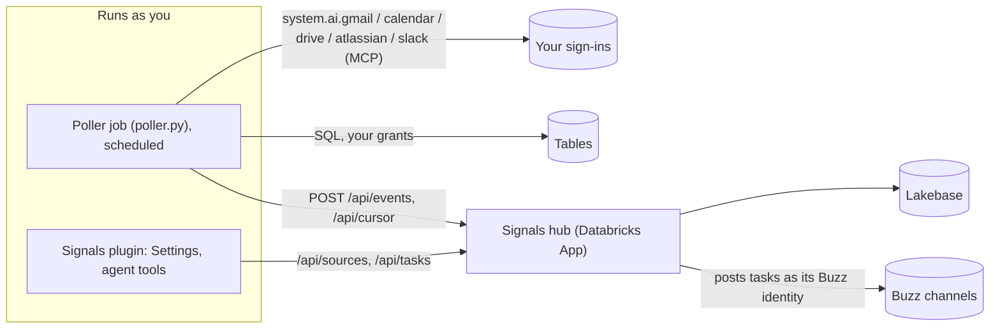

# Signals

Turn events from your own sources into tasks in your team's Buzz channels.

- **Sources** are read **as you**, with your own sign-ins: Gmail, Google Calendar, Google Drive, Jira (Atlassian), and Slack, through the Unity Catalog MCP services in `system.ai`, plus any Databricks table you can read.
- **Every source is off** until you turn it on in **Settings → Signals**. You can turn one off at any time, or use **Forget** to also delete what the hub keeps from it.
- **The hub** is a Databricks App with a Lakebase database. It keeps one record per thing (a mail, a meeting, a ticket, a table row) and notices when one changes. The team's **rules** then decide whether a change opens a task, updates a task, or is only recorded. New tasks are posted in their account's channel, and later events go in the task's thread.
- **Agents** get `signals_tasks`, `signals_task`, `signals_task_update` (status, notes, artifacts) and `signals_event`.

## How it fits together



**Why a job and not the app?** An app's on-behalf-of token lasts about six minutes, comes without a refresh token, and only arrives with a request. That makes it fine for the Settings card, but the app can't use it to read your mail at 3am, and its service principal can't use your sign-ins. A scheduled job owned by you runs as you and can.

## Deploy

1. **Build:** `npm run build` writes `plugins/signals/hub/`, which holds `app.mjs` (the hub plus its Postgres driver), `app.yaml`, `signals.config.json` (example rules), `poller.py` and `sources.example.json`.
2. **Hub:**
   1. Create a Databricks App whose description starts with **`Signals hub`**; that's how the plugin finds it.
   2. Give it a Lakebase database resource named `postgres` with *Can connect and create*.
   3. Upload `hub/` and deploy it.
   4. Give the people who'll use it **Can Use** on the app.
   5. To post tasks to Buzz, give it a Buzz identity: in Buzz, go to **Agents → New agent → Databricks App → Connect an app you have** and set `BUZZ_IDENTITY_SECRET` in `app.yaml`.
3. **Rules:** edit `signals.config.json` before deploying. Admins (set with `SIGNALS_ADMINS`) can also `POST /api/config`.
4. **Each person:**
   1. Turn sources on in **Settings → Signals**. If the hub runs in another workspace than Buzz's, pick it under **Workspace** there first; the agent tools follow that choice too.
   2. Create a scheduled job (serverless, every 15 minutes, say) **owned by them** that runs `poller.py --config sources.json --lakebase [--warehouse <id>]`, with `psycopg[binary]` as a dependency. Give them a Postgres role in the hub's database (Lakebase → Roles → add their Databricks identity).
   3. From a laptop signed in with `databricks auth login`, `--hub <app url>` works too, and replies with what each post did.
   4. Try it first with `--dry-run`, which reads every source and prints the events without the hub.

### How a job reaches the hub

Databricks Apps only take OAuth tokens, and a job's token isn't one, so a job can't call the hub's API. It can log in to Lakebase as its owner, though, so `--lakebase` writes to the hub's **inbox** table instead:

- Each person can insert only `kind` and `body`. The row's `owner` is always their own Postgres role (`current_user`), so a post can't claim to be from someone else.
- Row-level security shows each person only their own inbox rows and only their own `sources` rows (source, enabled, cursor, last post, last error). They can't change either table.
- The hub drains the inbox every 30 seconds, through the same path as `POST /api/events` and `POST /api/cursor`, and deletes handled rows after a week.
- Add to `sources.json`: `"lakebase": {"endpoint": "projects/<p>/branches/<b>/endpoints/<e>", "host": "<endpoint host>", "database": "databricks_postgres", "schema": "signals_<app name>"}`. The schema is on the hub's status page.
- Roles with `BYPASSRLS` (Lakebase project owners) aren't limited by these policies. They can read the database anyway.

## Rules

```json
{
  "version": 1,
  "first_run_seen": true,
  "accounts": [{ "name": "Example Co", "channel": "<buzz channel id>", "aliases": ["Example"], "when": { "actor": "@example\\.com" } }],
  "rules": [
    { "id": "no-automated-mail", "sources": ["gmail"], "when": { "actor": "noreply" }, "action": "ignore" },
    { "id": "customer-mail", "sources": ["gmail"], "when": { "actor": "@example\\.com" }, "action": "task", "title": "Reply: {title}", "group_by": "group_key" },
    { "id": "cases", "sources": ["table.*"], "when": { "payload.status": ["Awaiting Confirmation"] }, "action": "task", "group_by": "external_id", "stale_after_hours": 72, "nudge": "{external_id} has waited {hours}h" },
    { "id": "auto-increases", "sources": ["table.quota"], "when": { "payload.kind": "auto" }, "action": "update", "group": "quota", "group_by": "payload.workspace" },
    { "id": "quota-requests", "sources": ["table.quota"], "action": "task", "group": "quota", "group_by": "payload.workspace" }
  ]
}
```

- Rules are checked **in order**, and the first match wins.
  - In `when` and `unless`, a string is a case-insensitive regular expression and a list is a set of exact values.
  - Fields are the event's own (`title`, `actor`, `account`, `url`, `group_key`, `external_id`) or `payload.<name>`.
  - All `when` conditions must hold. Any one `unless` condition excludes the event.
- There are three actions:
  - `task` opens or updates the task for the event's group.
  - `update` only adds the event to a task that already exists for its group.
  - `ignore` records the event and does nothing else.
- **Groups:** events with the same `group_by` value share one task, across everyone. `group_by` is a field (`payload.workspace`) or a template (`{payload.workspace}/{payload.region}`; values are trimmed and lowercased, and an event whose fields are all empty is its own group). Rules with the same `group` (default: the rule's id) share tasks, so an `update` rule names the group of the rule that opens them. When two people get the same thread, it becomes one task.
- **First run:** with `first_run_seen` on, a source's first post for a person only records what's already there, so turning a source on doesn't flood the channel.
- **Nudges:** with `stale_after_hours`, an open task whose latest event still matches the rule after that many hours gets a nudge in its thread, at most once per period.
- **Accounts:** the account comes from the rule's `account`, then the event's own `account` (matched by name or alias), then the first account whose `when` holds. The account's `channel` is where its tasks are posted; tasks without one go to `default_channel`.

- **Labels:** `labels` sets what your deployment calls things, so the public defaults stay generic. `labels.customer` is the word for the people at an account (default "customer"; say "client"), used in agents' briefings, meeting attendee notes and the account panel. `labels.parties` names who a task from outside sits with on the tasks board, by key: `engineering` and `support` are always there (default "Engineering" and "Support"), and you can rename them or add more. A rule's `party` says which one its tasks sit with; without it, the board shows no party (parties are never guessed from the source's name). With a party, the board also shows the event's `owner` or `assignee`. For example:

  ```json
  "labels": { "customer": "client", "parties": { "support": "Customer Care", "partner": "Partner team" } },
  "rules": [{ "id": "partner-escalations", "sources": ["jira"], "party": "partner", "action": "task" }]
  ```

## Account channels

Open a channel's menu and choose **Set up account** to make it an account channel. You give it:
- **Account:** the name tasks show, plus any other names sources use for it.
- **Customer email domains:** mail and meetings from people at these domains go to this channel's tasks.
- **Team preferences:** plain text the team edits whenever it wants.

Tasks for the account are then posted in this channel. That includes tasks already open that had no channel yet. The panel lists the open tasks, grouped by initiative and workstream. Anyone who can use the hub can set up a channel, and the hub records who changed what. A registered account wins over a config account with the same name.

**Preferences.** A line `<workstream or rule id>: <mode>` sets how agents handle that kind of work, and `everything: <mode>` sets the default (`draft` when nothing says):

```text
- everything: draft
- meeting prep: auto
- tickets: off
Keep customer replies short. Copy the account owner on anything about pricing.
```

| Mode | What agents do |
|---|---|
| `auto` | Do the work and report it in the task's thread. |
| `draft` | Prepare it (a draft doc, a reply) for a person to send. |
| `ask` | Ask in the thread before doing anything. |
| `off` | No new tasks open. Tasks already open still get updates. |

Every other line is guidance that agents follow. A task keeps the mode it had when it opened, and its Buzz message shows it.

**Agents that work on tasks.** List agents (npubs or hex pubkeys) in the account's setup, and each new task's message mentions them, which wakes them in the task's thread:
- In `auto`, they are asked to do the work and report it.
- In `draft`, they are asked to post a draft for a person to send.
- In `ask` and `off`, nobody is mentioned, and a person starts the work.

The agents must be members of the channel. The hub needs a Buzz identity to post at all.

Agents don't need the Signals tools for this. The task's message includes what `signals_account` would give them: the account's modes, its customer domains, the team's guidance and the profile, cut down to fit. Each minute the hub checks the threads of the tasks it asked agents to work on, over the last 7 days. It records an agent's first reply on the task in three ways: as activity, as an artifact (`draft` in draft mode, otherwise `reply`) that links to the message, and by moving an `open` task to `in_progress`.

When you add an agent to an account, the hub asks it to pick up the account's open auto and draft tasks from the last 14 days, up to 20 of them, that no agent has replied to yet. It does this with a reply in each task's thread that mentions the agent and carries the account briefing. That reply is the agent's wake. Its first reply is then recorded the same way, and the save's response lists those tasks as `woken`.

Every task's post also shows its latest event: its link, when, who it's from, and where. For calendar events it lists the attendees, with people at the account's domains first and marked `customer`. Your own people often have an address at the customer's domain too. When a customer-domain address belongs to the same person as another attendee (the same name, or an address spelled from it, like `disburgh` for `dane.isburgh`), it is marked as theirs, not as a customer. It shows up to 1,500 characters of the description. It adds a short excerpt of the payload's other fields. A calendar source gets attendees and descriptions with `detail` (see `sources.example.json`), which fetches each event with `calendar_event_get`. Times show in the event's own time zone. A rule can match the attendees, with `when` on `payload.attendees`. For meeting prep, use `customer_attendees` instead, a pattern for the customer's email addresses, as the example `customer-meetings` rule does with `"customer_attendees": "@example\\.com$"`. The rule then applies only when the meeting has a real customer: someone the pattern matches who isn't also another attendee, so a team meeting that invites colleagues' customer-domain addresses doesn't open prep.

**Agents** get `signals_account` (the account, its preferences and its profile) and `signals_account_learn`, which replaces the profile agents keep of the customer and the team. Every agent turn is told to read the account before working on a task and to record what it learns. That profile is how the channel gets better over time. Agents can also file a task under a workstream or initiative with `signals_task_update`.

## Sources (`sources.json`)

- **`mcp` sources** call a tool of a `system.ai` service.
  - `args` and `map` are templates: `{since}` (the source's cursor, or `lookback_hours` back), `{now}`, `{now+7d}`, `{since_epoch}`, `{since_date}`, and `{field.path}` for a field of the item.
  - `items` is where the list sits in the tool's JSON.
  - When you aren't signed in, the source is reported as unavailable, with the sign-in link.
- **`table` sources** run a query with a `:since` parameter.
  - `table` is checked first. A table that's missing, or one you can't read, makes the source unavailable instead of failing.
  - The cursor is the largest `watermark` value seen.
- **`map`** turns an item into an event:
  - `external_id` (required)
  - `title`, `url`, `actor`, `account`, `group_key`, `occurred_at`
  - `payload`: a list of fields, `"*"` for the whole item, or an object of specs
  - Any spec can be `{"from": "<path or template>", "match": "<regex>"}`: the regex's first group (case-insensitive), or nothing without a match. For example, `{"from": "fields.summary", "match": "workspace (\\d+)"}` pulls a workspace id out of a ticket title.

The hub keeps each source's cursor. The cursor only moves once the hub has the events.

## Privacy

- The hub only takes events for sources the person turned on. Who sent an event comes from Databricks Apps (`X-Forwarded-Email`), never from the request body.
- Posts to Buzz contain only a task's title, account and links, never a mail's body.
